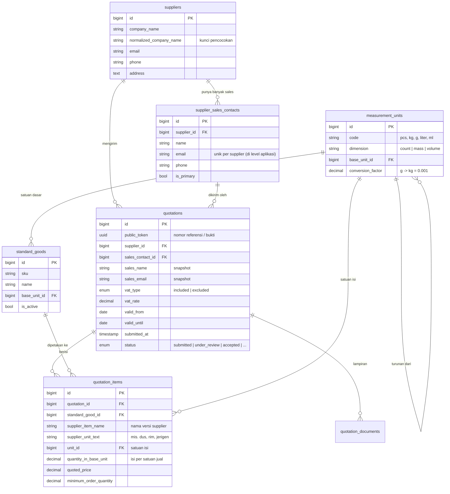

# Portal Penawaran Supplier via QR

Aplikasi web Laravel tempat sales dari supplier baru mendaftarkan perusahaan dan menawarkan produk cukup dengan memindai QR code. Tim procurement meninjau penawaran di dashboard internal dan membandingkan harga antar supplier secara adil (sudah termasuk PPN dan dalam satuan yang sama).

- **Stack:** PHP 8.4, Laravel 13, MySQL 8.4, Docker Compose
- **QR code:** [`docs/qr-supplier-offer.png`](docs/qr-supplier-offer.png) (mengarah ke `http://localhost:8000/supplier-offer`)
- **Skema database:** [`database/schema.sql`](database/schema.sql)

---

## Cara Menjalankan

```bash
docker compose up
```

Hanya itu. Saat container `app` pertama kali jalan, ia otomatis:

1. menyalin `.env.example` ke `.env` jika belum ada, dan membuat `APP_KEY`;
2. menunggu MySQL siap (healthcheck);
3. menjalankan migrasi dan seeder master data (satuan dan daftar barang rutin);
4. menyalakan server di **http://localhost:8000**.

| Halaman | URL | Akses |
|---|---|---|
| Poster QR (untuk dicetak/ditempel di lobi) | http://localhost:8000/supplier-qr | Publik |
| Form penawaran (tujuan QR) | http://localhost:8000/supplier-offer | Publik |
| Bukti penerimaan | http://localhost:8000/supplier-offer/receipt/{token} | Publik, butuh token |
| Dashboard procurement | http://localhost:8000/ | Basic Auth |

**Login dashboard (default lokal):** `procurement` / `procurement123`. Nilai ini bisa diganti dengan variabel `PROCUREMENT_USERNAME` dan `PROCUREMENT_PASSWORD` saat menjalankan compose.

**Email** disimulasikan (`MAIL_MAILER=log`) dan ditulis ke `storage/logs/laravel.log`.

**Mencoba dari HP:** QR dibuat dari host yang sedang membuka halaman. Buka `http://<IP-laptop>:8000/supplier-qr` dari laptop, lalu QR yang tampil akan mengarah ke IP tersebut dan bisa dipindai dari HP di jaringan yang sama.

### Menjalankan Tes

```bash
docker compose exec app php artisan test
# atau di mesin lokal: php artisan test
```

Tes selalu memakai SQLite in-memory. `phpunit.xml` memaksa koneksi lewat `$_SERVER`, dan `tests/TestCase.php` menolak berjalan jika koneksinya bukan SQLite, sehingga tes tidak pernah mengosongkan database MySQL dev.

---

## Alur Demo

1. Buka `/supplier-qr`, lalu pindai QR (atau klik "Buka Form Penawaran").
2. Isi form: identitas perusahaan, kontak sales, dan barang yang ditawarkan. Contoh: *Kertas HVS A4*, Rp 120.000 per **dus**, 1 dus = **12 pcs**, belum termasuk PPN 11%, berlaku sampai tanggal tertentu.
3. Sales diarahkan ke **halaman bukti penerimaan** berisi nomor referensi dan waktu kirim (bisa dicetak/disimpan PDF). Email konfirmasi tercatat di log.
4. Login ke dashboard `/`. Penawaran muncul di daftar dengan status *Submitted*.
5. Di bagian **Perbandingan Harga**, penawaran dikelompokkan per barang standar dan diurutkan dari harga termurah per satuan dasar, setelah PPN.
6. Procurement menindaklanjuti: **Tinjau**, lalu **Terima**, atau **Edit** jika sales salah memilih barang/satuan, atau **Hapus**.
7. Kirim penawaran kedua dengan nama `PT. MAJU JAYA` dan sales lain. Supplier dikenali sebagai perusahaan yang sama, dan dashboard menandai "Supplier lama · 2 penawaran, 2 sales".

---

## Skema Database



| Tabel | Fungsi |
|---|---|
| `suppliers` | Master perusahaan supplier. `normalized_company_name` dipakai untuk mengenali supplier yang datang lagi. |
| `supplier_sales_contacts` | Satu supplier bisa punya banyak sales. Sales pertama otomatis jadi kontak utama. |
| `quotations` | Header penawaran: PPN, masa berlaku, status, token publik untuk bukti penerimaan. Data sales disimpan sebagai *snapshot* agar riwayat tidak berubah jika kontak diperbarui. |
| `quotation_items` | Barang yang ditawarkan, dengan nama/satuan **versi supplier** plus pemetaan ke **barang standar** dan **isi per satuan**. |
| `standard_goods` | Daftar barang yang rutin dibeli perusahaan, masing-masing dengan satuan dasarnya. |
| `measurement_units` | Satuan standar dan konversinya ke satuan dasar dalam dimensi yang sama (g → kg, ml → liter). |
| `quotation_documents` | Disiapkan untuk lampiran (brosur/surat penawaran). Upload belum diimplementasikan, lihat *Keterbatasan*. |

`database/schema.sql` adalah hasil `mysqldump --no-data` dari migrasi yang sama. Master data awal ada di `database/seeders/SupplierQuotationSeeder.php`.

---

## Menilai Penawaran Paling Menguntungkan

Masalahnya: tiap supplier memakai nama dan satuan sendiri ("dus isi 12", "rim", "jerigen 5 L"), sebagian harga sudah termasuk PPN dan sebagian belum, dan harga hanya berlaku sampai tanggal tertentu.

Pendekatannya, semua penawaran diubah ke satu angka yang bisa dibandingkan: **harga setelah PPN per satuan dasar barang standar.**

1. **Pemetaan barang:** sales memilih barang standar dari daftar perusahaan, tapi tetap menulis nama dan kode barang versi mereka sendiri. Kalau sales salah pilih, procurement bisa mengoreksinya lewat menu Edit.
2. **Isi per satuan jual:** sales mengisi "1 *dus* = **12** *Pieces*". Inilah yang membedakan "dus" supplier A (isi 12) dari "dus" supplier B (isi 24); keduanya tidak dipaksa memakai faktor konversi global.
3. **Konversi satuan standar:** satuan isi dikonversi ke satuan dasar barang (mis. 500 g → 0,5 kg). Satuan yang tidak bisa dikonversi, misalnya kg untuk barang berbasis pcs, **ditolak saat submit** agar setiap penawaran yang masuk pasti bisa dibandingkan.
4. **PPN:** jika harga belum termasuk PPN, harga dikali `(1 + tarif/100)`.
5. **Masa berlaku:** hanya penawaran berstatus aktif (*submitted / under review / accepted*) yang `valid_until`-nya belum lewat yang ikut dibandingkan.

```
harga_normal = harga × (1 + PPN% jika belum termasuk) ÷ (isi_per_satuan × faktor_konversi)

Contoh: Rp 120.000/dus, belum PPN 11%, 1 dus = 12 pcs
        = 120.000 × 1,11 ÷ 12 = Rp 11.100 per pcs
```

Logika ini ada di [`app/Services/OfferComparison.php`](app/Services/OfferComparison.php) dan dites di `tests/Unit/OfferComparisonTest.php`. Dashboard juga menampilkan harga asli, isi kemasan, status PPN, dan MOQ di samping harga normal, karena harga termurah belum tentu paling menguntungkan jika MOQ-nya terlalu besar.

---

## Supplier yang Menawarkan Ulang

Supplier yang sama bisa datang lagi, kadang dengan sales yang berbeda. Penanganannya:

1. **Pencocokan perusahaan dengan nama yang dinormalisasi.** `Supplier::normalizeName()` mengubah ke huruf kecil, menghapus tanda baca, dan membuang bentuk badan usaha (PT, CV, UD, Tbk, Persero). Jadi `PT. Maju Jaya`, `pt maju jaya`, dan `Maju Jaya, Tbk` menjadi satu supplier, tanpa duplikat.
2. **Sales dicocokkan berdasarkan email di dalam supplier tersebut.** Sales yang sama memakai kontak yang sama, sedangkan sales baru ditambahkan sebagai kontak baru di supplier yang sama. Sales pertama menjadi kontak utama.
3. **Setiap kunjungan adalah penawaran baru.** Penawaran lama tidak ditimpa, sehingga riwayat harga per supplier tetap ada dan bisa dibandingkan dari waktu ke waktu.
4. **Data master tidak ditimpa dari form publik.** Jika supplier sudah ada, form hanya melengkapi field yang masih kosong. Tanpa ini, siapa pun bisa mengganti email resmi supplier hanya dengan mengetik nama perusahaannya.
5. **Snapshot sales di penawaran.** Nama/email/telepon sales disimpan juga di `quotations`, sehingga penawaran lama tetap menunjukkan siapa yang mengirim walaupun data kontak berubah.
6. **Terlihat di dashboard:** penawaran dari supplier yang sudah pernah menawarkan ditandai dengan jumlah penawaran dan jumlah sales.

**Keterbatasan yang disadari:** pencocokan berbasis nama bisa keliru untuk perusahaan berbeda yang namanya mirip (mis. "CV Maju Jaya" dan "PT Maju Jaya" dianggap sama). Kunci yang lebih kuat adalah **NPWP**. Saya tidak mewajibkannya karena sales di lobi belum tentu hafal NPWP perusahaannya. Untuk produksi, saya sarankan NPWP sebagai field opsional yang menjadi prioritas pencocokan bila diisi.

---

## Asumsi

- Satu kali submit form berisi **satu barang**. Untuk barang lain, sales mengirim penawaran lagi (setiap penawaran mendapat nomor referensi sendiri). Skema sudah mendukung banyak item per penawaran, tapi UI multi-item belum dibuat agar form di HP tetap singkat.
- Mata uang selalu **IDR**.
- Daftar barang rutin dan satuan dikelola procurement (saat ini lewat seeder, tanpa UI admin).
- Setiap barang punya satu satuan dasar. Konversi hanya dalam dimensi yang sama (jumlah, massa, volume).
- `valid_from` adalah tanggal submit, dan `valid_until` wajib diisi dan tidak boleh di masa lalu.
- Penawaran kedaluwarsa tidak diubah statusnya secara otomatis. Penawaran itu cukup dikeluarkan dari perbandingan berdasarkan tanggal.
- Bukti penerimaan untuk sales berupa halaman dengan nomor referensi (UUID) yang bisa dicetak/disimpan PDF, plus email konfirmasi (disimulasikan ke log).
- Dashboard dipakai oleh satu tim kecil dengan satu akun bersama (Basic Auth).

---

## Keputusan Desain dan Ide Tambahan

| Keputusan | Alasan |
|---|---|
| **Isi per satuan jual diisi oleh sales** | Orang yang paling tahu isi "1 dus" adalah sales-nya sendiri. Faktor global di master satuan tidak akan pernah benar untuk semua supplier. |
| **Satuan yang tidak bisa dikonversi ditolak di form** | Lebih baik sales langsung diberi tahu daripada penawarannya diam-diam hilang dari perbandingan. |
| **Halaman bukti + email + token UUID** | Sales butuh bukti penawarannya diterima. Token acak (bukan ID berurutan) membuat bukti bisa dibagikan tanpa membuka data penawaran lain. |
| **Form publik tidak bisa menimpa master supplier** | Mencegah *data poisoning* dari form tanpa login. |
| **Snapshot sales di penawaran** | Riwayat tetap akurat walau kontak berubah. |
| **Harga asli, isi kemasan, PPN, dan MOQ ditampilkan di samping harga normal** | Procurement perlu melihat alasan di balik angka, bukan hanya peringkatnya. |
| **Logika perbandingan dipisah ke service** | Bisa dites unit tanpa database, dan dipakai ulang jika nanti ada API/ekspor. |
| **Form mobile-first, satu halaman, tanpa login** | Sales berdiri di lobi dengan HP. Setiap field atau langkah tambahan menurunkan jumlah penawaran yang selesai dikirim. |
| **Status alur:** Submitted → Under Review → Accepted | Procurement bisa menandai mana yang sedang ditangani. Transisi yang tidak valid ditolak. |

---

## Keamanan

Form ini publik, tanpa login, dan siapa pun yang memegang link QR bisa membukanya. Berikut risiko yang saya identifikasi.

### Sudah ditangani

| Area | Risiko | Mitigasi |
|---|---|---|
| Dashboard | Data penawaran dan kontak supplier bisa diakses orang luar | Semua route internal dilindungi Basic Auth (`ProcurementBasicAuth`), perbandingan kredensial *timing-safe* (`hash_equals`), dan **fail-closed**: jika kredensial belum dikonfigurasi, dashboard mengembalikan 503 alih-alih terbuka. |
| API internal | `GET /api/suppliers` membocorkan email/telepon semua supplier, `POST` bisa membuat supplier palsu | Seluruh `/api/*` memakai middleware auth yang sama. |
| Form publik | Spam/flood penawaran oleh bot | Rate limit **5 submit per menit per IP** dan honeypot field tersembunyi. |
| Dashboard | Brute force password Basic Auth | Rate limit 60 request per menit per IP. |
| Form publik | Penimpaan data master supplier oleh orang lain | Supplier yang sudah ada tidak bisa diubah dari form, hanya field kosong yang dilengkapi. |
| Bukti penerimaan | Enumerasi penawaran lain lewat URL | Token UUID v4 (122 bit acak), bukan ID berurutan. Halaman hanya menampilkan nama perusahaan, status, dan waktu. |
| Input | SQL injection, XSS, CSRF, mass assignment | Query Eloquent dengan binding, Blade auto-escape `{{ }}`, token CSRF di semua form, `$fillable` di model, serta validasi server-side dengan batas panjang di setiap field. |
| Data | Satuan/harga tidak valid merusak perbandingan | Validasi harga > 0, tanggal berlaku tidak di masa lalu, satuan harus bisa dikonversi. |
| Rahasia | Kredensial bocor di repo | `.env` di-*gitignore*. Kredensial dashboard dibaca dari env. |
| Tes | Tes menghapus database dev | Env tes dipaksa ke SQLite in-memory, dan ada guard di `TestCase`. |

### Belum ditangani (dan alasannya)

| Risiko | Kenapa belum | Rekomendasi |
|---|---|---|
| **Tidak ada HTTPS**, padahal Basic Auth mengirim kredensial dalam base64 | Soal hanya meminta localhost | **Prioritas pertama sebelum produksi:** pasang TLS di reverse proxy. |
| **Kredensial default dan `APP_DEBUG=true` di `compose.yaml`** | Supaya `docker compose up` langsung bisa didemokan | Wajib diganti dan `APP_DEBUG=false` di produksi, karena halaman error debug membocorkan konfigurasi. |
| **Satu akun bersama, tanpa audit log** | Cukup untuk tim kecil, dan login per user menambah scope | Ganti ke login per user (Laravel Breeze/Fortify) dan catat siapa yang menerima, mengedit, atau menghapus penawaran. Penting karena *hapus* saat ini permanen. |
| **Identitas sales tidak diverifikasi**, sehingga siapa pun bisa mengaku dari perusahaan mana pun | Verifikasi email (OTP/link) menambah langkah di lobi | Penawaran baru tetap berstatus *Submitted* sampai ditinjau manusia. Langkah berikutnya: tandai "email terverifikasi" lewat link konfirmasi, tanpa memblokir submit. |
| **Penggantian QR fisik** (QR palsu ditempel di atas QR asli, mengarah ke situs phishing) | Risiko fisik, di luar kode | Cetak URL resmi di poster di samping QR, pakai stiker tahan rusak, dan cek poster secara berkala. |
| **CAPTCHA** tidak dipakai | Honeypot + rate limit cukup untuk ancaman saat ini, dan CAPTCHA mempersulit sales di HP | Tambahkan (mis. Turnstile) hanya jika spam terbukti lolos. |
| **Rate limit per IP** bisa diakali dengan rotasi IP, dan sales di Wi-Fi lobi yang sama berbagi satu IP | Trade-off yang diterima | Pantau log 429. Naikkan batas atau gunakan kombinasi IP + email jika sales sah terblokir. |
| **Data pribadi (PII) tidak dienkripsi at rest**, tidak ada kebijakan retensi | Butuh keputusan bisnis/kebijakan | Enkripsi kolom kontak, tetapkan masa simpan, dan sediakan penghapusan atas permintaan (UU PDP). |
| **Security headers** (CSP, X-Frame-Options, HSTS) | Lebih tepat diatur di reverse proxy | Atur di Nginx/proxy saat deploy. |
| **Port MySQL (3307) dibuka ke host** | Memudahkan inspeksi database saat demo | Hapus mapping port di produksi. |
| **Upload lampiran** belum ada | Fitur belum dibuat, jadi belum ada permukaan serangan | Jika ditambahkan: whitelist MIME, batas ukuran, simpan di disk privat, dan nama file acak. |

**Alasan prioritas:** yang saya kerjakan duluan adalah risiko yang (1) bisa dieksploitasi dari luar tanpa akses apa pun dan (2) murah ditutup di level aplikasi: dashboard dan API terbuka, spam form, penimpaan data master, serta enumerasi bukti penerimaan. Sisanya bergantung pada infrastruktur deploy (TLS, header, port), keputusan kebijakan (PII, retensi), atau punya trade-off UX (CAPTCHA, verifikasi email) yang sebaiknya diputuskan bersama tim procurement.

---

## Automated Test

| File | Yang dites |
|---|---|
| `tests/Unit/OfferComparisonTest.php` | Pembagian isi kemasan, penambahan PPN (dan tidak ditambah dua kali), konversi g → kg, penolakan satuan tidak kompatibel, urutan termurah |
| `tests/Unit/SupplierNameTest.php` | Variasi nama perusahaan (PT/CV/Tbk/tanda baca/spasi) dikenali sebagai supplier yang sama |
| `tests/Feature/SupplierOfferSubmissionTest.php` | Submit sukses dan bukti penerimaan, supplier yang menawarkan ulang dengan sales baru/lama, master data tidak tertimpa, validasi satuan/tanggal, honeypot, rate limit, token tidak dikenal |
| `tests/Feature/ProcurementDashboardTest.php` | Auth dashboard dan API, fail-closed tanpa kredensial, peringkat perbandingan dan pengecualian penawaran kedaluwarsa, alur status |

---

## Keterbatasan dan Pengembangan Berikutnya

- Form multi-item (satu kunjungan, banyak barang) dengan UI tambah baris.
- Aksi **Tolak** dengan alasan, dan notifikasi status ke sales lewat email.
- Penandaan otomatis status *expired* lewat scheduler, dan pengingat ke procurement sebelum penawaran terbaik kedaluwarsa.
- UI admin untuk mengelola barang rutin dan satuan.
- Upload brosur/surat penawaran (tabel `quotation_documents` sudah disiapkan).
- "Barang lain-lain" untuk produk yang belum ada di daftar barang rutin, agar procurement bisa menemukan supplier untuk kebutuhan baru.
- Perbandingan dengan riwayat harga (apakah harga naik/turun dari penawaran sebelumnya).
